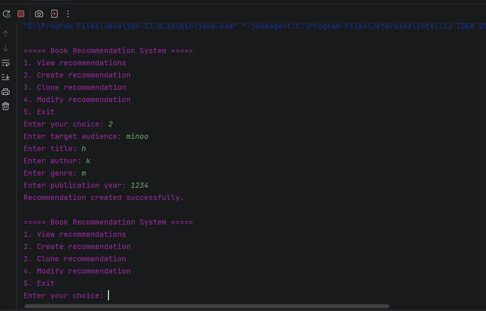

# Book Recommendation System

This is my Java assignment for the Prototype design pattern.

## About the project

The idea of this project is to create book recommendation lists for different groups of readers. Instead of creating a new list every time, the user can clone an existing list and modify it.

## What I implemented

- Book class with author, title, genre and publication year.
- Recommendation class with a target audience and a list of books.
- Deep cloning using the Prototype pattern.
- A simple command-line menu.
- Adding, removing and editing books.
- Creating and cloning recommendation lists.

## Prototype Pattern

I used the Cloneable interface and the clone() method in Java.

In the Recommendation class, I created a new list and cloned each book separately. This means that changing a cloned recommendation does not affect the original one.

## How to run

1. Open the project in IntelliJ IDEA.
2. Open Main.java.
3. Click the Run button.
4. Select an option from the menu.

## Program Output

## What I learned

During this assignment, I learned how the Prototype pattern works and the difference between shallow copy and deep copy.

I also learned how to use Java packages and manage objects inside a list.

The recommendations are stored in memory while the program is running.
